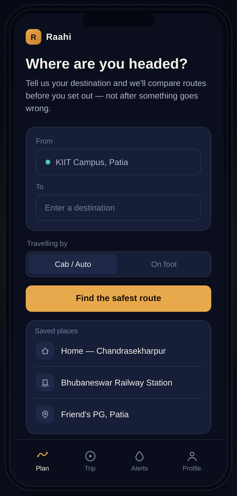
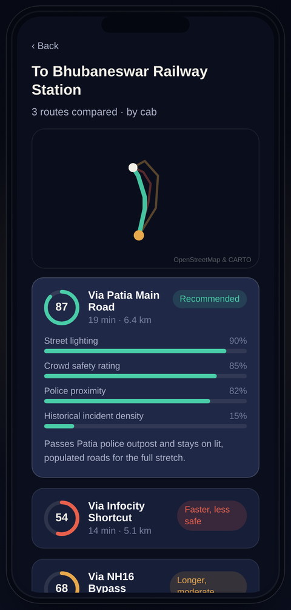
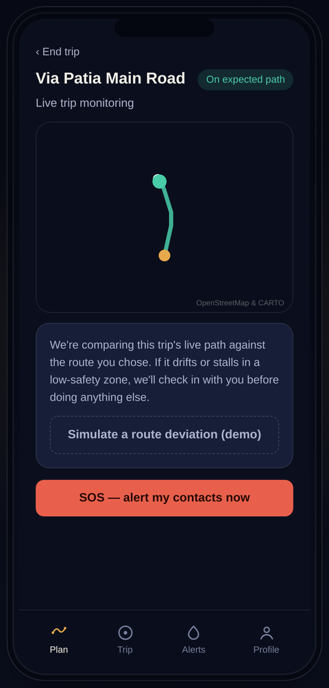
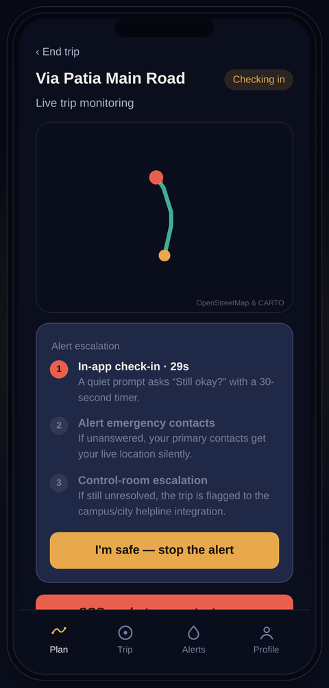
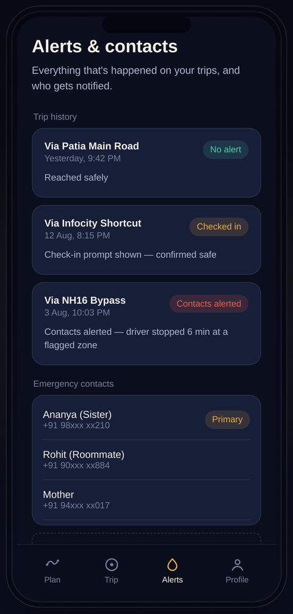
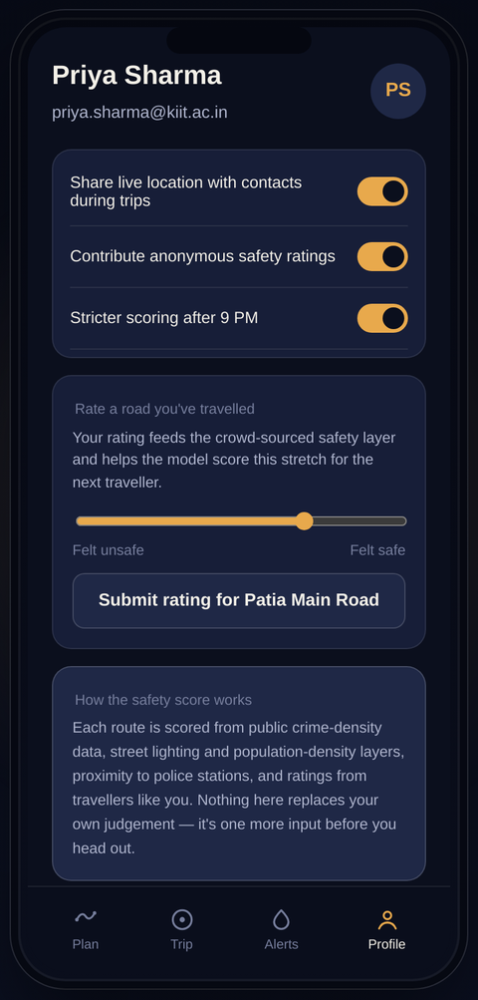

# Raahi — AI-Based Women Safety Route Advisor (UI Prototype)

A front-end prototype of the app described in *AI-Based Women Safety Route Advisor for Cab and Solo Travel*
(KIIT School of Electronics Engineering final-year project). This repo is the **UI layer** — a working
React app with realistic mock data standing in for the trained route-scoring model and a live GPS feed,
so the product experience can be demoed, tested, and iterated on before the ML/backend pieces are wired in.

Every screen below is a real screenshot of the app running, not a mockup.

---

## Screens & functionality

### 1. Plan a trip



The entry point. The user's current location is filled in automatically (`KIIT Campus, Patia` in this
demo); they type or pick a destination, and choose whether they're travelling by **cab/auto** or **on
foot** — the two travel modes named in the proposal, since the safety factors that matter differ between
them. Tapping a saved place jumps straight to route comparison. A "Find the safest route" button is the
single primary action on the screen — nothing else competes for attention.

**Maps to proposal objective:** *"a simple, intuitive front-end where a user can enter source and
destination."*

### 2. Compare routes



All candidate routes are plotted on one live OpenStreetMap map, color-coded by safety score (teal =
safer, amber/coral = riskier), with the selected route drawn on top and bold. Below the map, each route
is a card with:

- A **safety score ring** (0–100) — the output of the proposal's weighted scoring model
- Trip time and distance
- A status tag (`Recommended`, `Faster, less safe`, `Longer, moderate`)
- On tap, a **factor breakdown** — street lighting, crowd safety rating, police proximity, and historical
  incident density, each as a percentage bar — plus a one-line, plain-language reason (e.g. *"passes
  Patia police outpost and stays on lit, populated roads"*)

This makes the model's reasoning visible instead of just handing over a black-box number, which matters
for a safety tool the user has to trust enough to act on.

**Maps to proposal objective:** *"design an AI model that scores and ranks candidate travel routes... and
instantly view the safest recommended route with a safety score."*

### 3. Live trip monitoring



Once a trip starts, a live marker (simulated GPS in this demo) tracks along the chosen route on the map,
with a status pill confirming the trip is **on the expected path**. This is the always-on background
state — quiet and reassuring when everything is normal.

### 4. Deviation & graded alert escalation



If the live path drifts from the recommended route or stalls in a low-safety zone (triggerable here via a
demo button, or manually via the **SOS** button), the screen switches into an escalation view showing
exactly where things stand:

1. **In-app check-in** — a quiet "Still okay?" prompt with a visible countdown
2. **Alert emergency contacts** — live location sent silently if step 1 goes unanswered
3. **Control-room escalation** — flagged to a campus/city helpline integration if step 2 goes unresolved

The user can cancel the whole sequence at any point with **"I'm safe — stop the alert."** Showing the
steps as a checklist (rather than jumping straight to "contacts alerted") is deliberate — it should feel
like an escalating conversation, not a sudden siren.

**Maps to proposal objective:** *"a graded alert-escalation system: in-app safety check-in → automatic
alert to emergency contacts → simulated helpline/control-room escalation."*

### 5. Alerts & emergency contacts



A log of past trips and what happened on each (reached safely / checked in / contacts alerted), plus the
emergency contact list with a primary contact marked. This is where a user would audit their own safety
history or manage who gets notified.

### 6. Profile & the crowd-sourced safety layer



Three things live here:

- **Privacy toggles** — live-location sharing during trips, contributing anonymous safety ratings, and
  stricter scoring after 9 PM — so safety features are opt-in and explainable, not silently on
- **Rate a road you've travelled** — a slider that feeds the crowd-sourced safety layer described in the
  proposal, so the model keeps improving from real traveller feedback
- **"How the safety score works"** — a plain-language explanation of the inputs behind the score, with an
  explicit reminder that it doesn't replace the user's own judgement

**Maps to proposal objective:** *"a crowd-sourced safety-rating layer where users can rate roads/areas,
continuously improving the model's accuracy over time."*

---

## Design notes

The visual language leans into the "safer path through the dark" idea the proposal is built around: a
deep-navy, near-black palette (so it reads well at night, when this app matters most), an amber accent
for primary actions and "moderate" signal, teal for "safe," and coral for alerts — rather than a generic
light SaaS theme. Space Grotesk is used for headings and IBM Plex Sans for body text. The whole UI is
built mobile-first inside an on-page phone frame.

## Tech stack

- React 19 + Vite 5
- `react-leaflet` / Leaflet with free OpenStreetMap + CARTO dark tiles (no API key needed)
- Plain CSS with a small design-token system in `src/index.css` — no UI framework

All data in `src/lib/mockData.js` is fabricated for the demo (routes are placed around the KIIT/Bhubaneswar
area). Swap that file, or the `useTripSimulation` hook, for real API calls once the scoring model and a
live GPS feed exist.

## Run it locally

Requires [Node.js](https://nodejs.org) 18+.

```bash
npm install
npm run dev
```

Then open the printed local URL (usually `http://localhost:5173`). To produce a production build:

```bash
npm run build
npm run preview
```

## Project structure

```
docs/screenshots/         # the screenshots used above
src/
  App.jsx                 # screen router (plan / results / trip / tabs)
  index.css                # design tokens (color, type, radius)
  components/
    PhoneFrame.jsx/.css    # the on-page phone mockup + backdrop
    BottomNav.jsx/.css     # tab bar
    MapView.jsx/.css       # Leaflet map wrapper
    SafetyScoreRing.jsx    # circular score indicator
    StatusPill.jsx         # colored status chip
  screens/
    PlanScreen.jsx         # destination input
    RouteResultsScreen.jsx # route comparison + scores
    LiveTripScreen.jsx     # live monitoring + escalation demo
    AlertsScreen.jsx       # trip history + contacts
    ProfileScreen.jsx      # settings + safety-rating widget
  lib/
    mockData.js             # routes, contacts, alert history
    useTripSimulation.js    # drives the simulated GPS marker
```

## Opening in VS Code

```bash
git clone https://github.com/anjalikumariaka12-ui/WomenSafetyFullStackAI-Application.git
cd WomenSafetyFullStackAI-Application/women-safety-app
code .
```

## Backend

A FastAPI backend lives in `../backend` (model serving, route ranking, live-trip monitoring, alerts). See `../DEPLOY.md`.
Set `VITE_API_URL` (see `.env.example`) to use it; without it the app falls back to the mock data above.

## Next steps toward the full proposal

- Replace `mockData.js` route scoring with calls to the trained scikit-learn/TensorFlow route-scoring
  model described in the proposal.
- Replace `useTripSimulation` with a real GPS feed and the time-series anomaly-detection model.
- Add authentication and a backend (Flask/Django or Node.js) with Firebase/SQLite, per the proposal's
  tooling list.
- Wire the "Alert emergency contacts" step to an SMS/notification provider.
